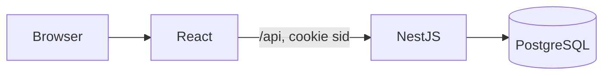

# Peer review double-blind pentru proiecte

Proiect P12, Web Avansat, anul 3. Studenții își evaluează reciproc proiectele, anonim în ambele sensuri, pe o grilă definită de profesor. Sistemul alocă automat evaluatorii, îi calibrează și agregă notele.

Cerințele complete sunt în [docs/brief.md](docs/brief.md).

## Scope

Roluri: student, profesor, admin. Aplicația finală acoperă:

- teme cu grilă de evaluare și termene;
- predări și alocarea automată a evaluatorilor;
- evaluare double-blind, cu feedback obligatoriu per criteriu;
- calibrare, fiabilitatea evaluatorului și agregarea notelor;
- contestații, nota de evaluator și export CSV.

## Stack

| Parte | Tehnologie | Decizie |
|---|---|---|
| API | TypeScript, NestJS 11 | D-001, D-002, D-008 |
| Interfață | React, Vite | D-001, D-006 |
| Bază de date | PostgreSQL 17, Prisma 7 | D-001, D-004 |
| Autentificare | sesiuni în cookie `httpOnly`, argon2 | D-003, D-005 |
| Teste și CI | Jest, supertest, GitHub Actions | |
| Deploy | Render (aplicația), Supabase (PostgreSQL), Frankfurt | D-009 |

Deciziile sunt în [docs/agents/DECISIONS.md](docs/agents/DECISIONS.md).

## Client și date reale

Input-ul uman este un pilot real cu minim 8 colegi și o discuție cu un cadru didactic.

| Element | Stare |
|---|---|
| Cadrul didactic intervievat | de completat (Q-003) |
| Colegii din pilot | de completat |
| Materialul evaluat în pilot | de stabilit cu profesorul (Q-002) |

## Variabilele personale

| Variabilă | Valoare |
|---|---|
| Grila folosită în pilot și k | de stabilit cu colegii (Q-004) |
| Metoda de agregare și de calcul al fiabilității | de stabilit (Q-005) |
| Ce l-ar face pe cadrul didactic să folosească rezultatele | de aflat din interviu (Q-003) |

## Arhitectură



Detalii în [docs/agents/ARCHITECTURE.md](docs/agents/ARCHITECTURE.md). Schema bazei de date este în [docs/db-schema.md](docs/db-schema.md), iar rutele API în [docs/API.md](docs/API.md).

## Rulare locală

Ai nevoie de Node.js 22 sau mai nou și de Docker.

```bash
cp .env.example .env        # apoi înlocuiește valorile change_me
docker compose up -d --wait
npm ci
npm run db:migrate
npm run db:seed
npm run build
npm start                   # http://localhost:3000
```

Pentru dezvoltare, în două terminale: `npm run dev:api` și `npm run dev:web` (http://localhost:5173).

Testele folosesc baza `peer_review_test`, creată automat de Docker Compose:

```bash
npm test
```

### Conturi de test

Parolele sunt cele din `.env`, variabilele `SEED_*`.

| Email | Rol |
|---|---|
| `admin@peer-review.test` | admin |
| `profesor@peer-review.test` | profesor |
| `student@peer-review.test` | student |

## Variabile de mediu

Lista este în [.env.example](.env.example). Fișierul `.env` nu intră în Git.

| Variabilă | Rol |
|---|---|
| `POSTGRES_USER`, `POSTGRES_PASSWORD`, `POSTGRES_DB` | baza de date din Docker |
| `DATABASE_URL` | conexiunea aplicației |
| `TEST_DATABASE_URL` | conexiunea testelor |
| `SESSION_SECRET` | semnarea cookie-ului de sesiune |
| `PORT` | portul serverului |
| `SEED_ADMIN_PASSWORD`, `SEED_PROFESSOR_PASSWORD`, `SEED_STUDENT_PASSWORD` | parolele conturilor de test |

## Ce e gata și ce nu

Gata:

- schema bazei de date, cu migrări și constrângeri;
- Docker Compose pentru PostgreSQL;
- autentificare, deconectare și roluri verificate pe server;
- paginile de autentificare și de start;
- teste automate și CI;
- deploy pe Render, cu baza de date pe Supabase.

Nu e gata:

- invitațiile pe email;
- temele, predările, alocarea, evaluările, agregarea și contestațiile;
- pilotul cu colegii.

Lista de task-uri este în [TODO.md](TODO.md), iar întrebările deschise în [docs/agents/OPEN-QUESTIONS.md](docs/agents/OPEN-QUESTIONS.md).
