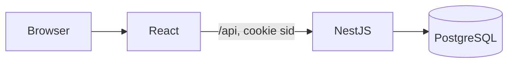

# Peer review double-blind pentru proiecte

Proiect P12, Web Avansat, anul 3. Studenții își evaluează reciproc proiectele, anonim în ambele sensuri, pe o grilă definită de profesor. Sistemul alocă automat evaluatorii, îi calibrează și agregă notele.

Cerințele complete sunt în [docs/brief.md](docs/brief.md).

Aplicația live: https://peer-review-double-blind-pentru-proiecte.onrender.com. Pe planul gratuit Render oprește serverul după 15 minute fără trafic; un job pe cron-job.org accesează `/api/health` la fiecare 10 minute ca să-l țină pornit.

## Scope

Roluri: student, profesor, admin. Aplicația finală acoperă:

- teme cu grilă de evaluare și termene;
- predări și alocarea automată a evaluatorilor;
- evaluare double-blind, cu feedback obligatoriu per criteriu;
- calibrare, fiabilitatea evaluatorului și agregarea notelor;
- contestații, nota de evaluator și export CSV.

## Stack

| Parte | Tehnologie | Decizie |
|---|---|---|
| API | TypeScript, NestJS 11 | D-001, D-002, D-008 |
| Interfață | React, Vite | D-001, D-006 |
| Bază de date | PostgreSQL 17, Prisma 7 | D-001, D-004 |
| Autentificare | sesiuni în cookie `httpOnly`, argon2, cont cu email `@ulbsibiu.ro` verificat | D-005, D-010 |
| Teste și CI | Jest, supertest, GitHub Actions | |
| Deploy | Render (aplicația), Supabase (PostgreSQL), Frankfurt | D-009 |

Deciziile sunt în [docs/agents/DECISIONS.md](docs/agents/DECISIONS.md): indexul, pe teme, cu legături la fișierele din [docs/agents/decisions/](docs/agents/decisions/).

## Client și date reale

Input-ul uman este un pilot real cu minim 8 colegi și o discuție cu un cadru didactic.

| Element | Stare |
|---|---|
| Cadrul didactic intervievat | de completat (Q-003) |
| Colegii din pilot | de completat |
| Materialul evaluat în pilot | de stabilit cu profesorul (Q-002) |

## Variabilele personale

| Variabilă | Valoare |
|---|---|
| Grila folosită în pilot și k | de stabilit cu colegii (Q-004) |
| Metoda de agregare și de calcul al fiabilității | media nivelurilor ponderată cu fiabilitatea evaluatorilor, pe scara 1–10; fiabilitatea = 1 − abaterea medie față de calibrarea profesorului sau față de mediana colegilor, minim 0,2, semnalat sub 0,6 (D-025) |
| Ce l-ar face pe cadrul didactic să folosească rezultatele | de aflat din interviu (Q-003) |

## Arhitectură



Detalii în [docs/agents/ARCHITECTURE.md](docs/agents/ARCHITECTURE.md). Schema bazei de date este în [docs/db-schema.md](docs/db-schema.md), iar rutele API în [docs/API.md](docs/API.md).

## Rulare locală

Ai nevoie de Node.js 22 sau mai nou și de Docker.

```bash
cp .env.example .env        # apoi înlocuiește valorile change_me
docker compose up -d --wait
npm ci
npm run db:migrate
npm run db:seed
npm run build
npm start                   # http://localhost:3000
```

Pentru dezvoltare, în două terminale: `npm run dev:api` și `npm run dev:web` (http://localhost:5173).

Testele folosesc baza `peer_review_test`, creată automat de Docker Compose:

```bash
npm test
```

### Conturi de test

Parolele sunt cele din `.env`, variabilele `SEED_*`.

| Email | Rol |
|---|---|
| `admin@peer-review.test` | admin |
| `profesor@peer-review.test` | profesor |
| `student@peer-review.test` | student |

## Variabile de mediu

Lista este în [.env.example](.env.example). Fișierul `.env` nu intră în Git.

| Variabilă | Rol |
|---|---|
| `POSTGRES_USER`, `POSTGRES_PASSWORD`, `POSTGRES_DB` | baza de date din Docker |
| `DATABASE_URL` | conexiunea aplicației |
| `TEST_DATABASE_URL` | conexiunea testelor |
| `SESSION_SECRET` | semnarea cookie-ului de sesiune |
| `PORT` | portul serverului |
| `SEED_ADMIN_PASSWORD`, `SEED_PROFESSOR_PASSWORD`, `SEED_STUDENT_PASSWORD` | parolele conturilor de test |

## Ce e gata și ce nu

Gata:

- schema bazei de date, cu migrări și constrângeri;
- Docker Compose pentru PostgreSQL;
- autentificare cu limită de încercări, deconectare și roluri verificate pe server;
- înscriere prin linkul temei, doar cu email `@ulbsibiu.ro` confirmat, și „Am uitat parola”; o parolă nouă nu poate fi una des folosită (lista NCSC din SecLists), un singur caracter repetat sau numele din adresă (D-030, după feedback-ul colegilor);
- limita de emailuri (înscriere, retrimiterea confirmării, „Am uitat parola”): cel mult 3 pentru aceeași adresă și 20 de pe același IP în 15 minute, nu într-o oră (D-033, după feedback-ul colegilor);
- limită de cereri împotriva refresh-ului repetat: peste 120 de cereri pe minut de la un cont (sau de la un IP, fără cont) API-ul răspunde „Prea multe cereri” până trece minutul (D-031, după feedback-ul colegilor);
- teste automate și CI;
- deploy pe Render, cu baza de date pe Supabase;
- pentru profesor și admin: schițe de grile, trimiterea unei grile către o clasă, grile active cu termene, clase și echipe cu cod de intrare;
- pentru admin: grilele fiecărui profesor, doar citire;
- pentru student: intrarea în echipă cu codul primit și predarea proiectului (link și fișier PDF, DOCX, PPTX, ODT, ODP sau ZIP cu codul sursă, curățat de autor; la ZIP se scot și `.git`, `node_modules`, folderele de build și autorii, linkurile de repo și contactele din `package.json` și `composer.json`, D-032) până la termenul de predare;
- alocarea automată a evaluatorilor după termenul de predare, cu retrageri și sosiri târzii, printr-un job pg-boss care rulează în fiecare minut;
- evaluarea double-blind: evaluatorul vede proiectul și grila, niciodată echipa, și trimite o singură dată un nivel și cel puțin 20 de caractere de feedback la fiecare criteriu;
- notificări pe email și în aplicație: proiecte primite de evaluat și amintiri cu 24 de ore înaintea termenelor de predare și de evaluare;
- calibrarea: profesorul evaluează o singură dată proiectele pe care le alege, ca referință pentru evaluatori;
- fiabilitatea evaluatorului și agregarea notelor ca funcții pure: profesorul vede nota fiecărei echipe (1–10, provizorie până la termenul de evaluare) și evaluatorii doar ca numere, cu fiabilitatea lor și cei semnalați;
- pagina de rezultate (meniul „Rezultate”): după termenul de evaluare, echipa vede nota și fiecare pas al calculului, ponderea fiecărui evaluator, nivelurile și feedback-ul; profesorul vede aceeași pagină pentru fiecare echipă;
- contestații: între termenul de evaluare și cel de contestații, un membru al echipei contestă nivelul dat de un evaluator la un criteriu, cu argument; profesorul admite cu nivelul corect sau respinge, motivat, iar echipa primește o notificare; nivelul admis intră în notă, iar istoricul rămâne pe pagina de rezultate;
- nota de evaluator: fiecare evaluare primește 1 + 9 × (70% acuratețe față de calibrarea profesorului sau mediana colegilor + 30% calitatea feedback-ului, notată opțional de profesor de la 1 la 5), o evaluare netrimisă la termen are nota 1, iar nota de evaluator e media lor; studentul își vede doar nota lui, explicată, după termenul de contestații, iar profesorul vede notele doar după numărul evaluatorului (D-028);
- exportul CSV: profesorul descarcă, după alocare, notele echipelor și evaluatorii (doar ca numere) în două fișiere care se deschid direct în Excel în limba română (D-029).

Nu e gata:

- pilotul cu colegii, interviul cu cadrul didactic, `AI_LOG.md` și `SUBMISSION.md`.

Lista de task-uri este în [TODO.md](TODO.md), iar întrebările deschise în [docs/agents/OPEN-QUESTIONS.md](docs/agents/OPEN-QUESTIONS.md).
