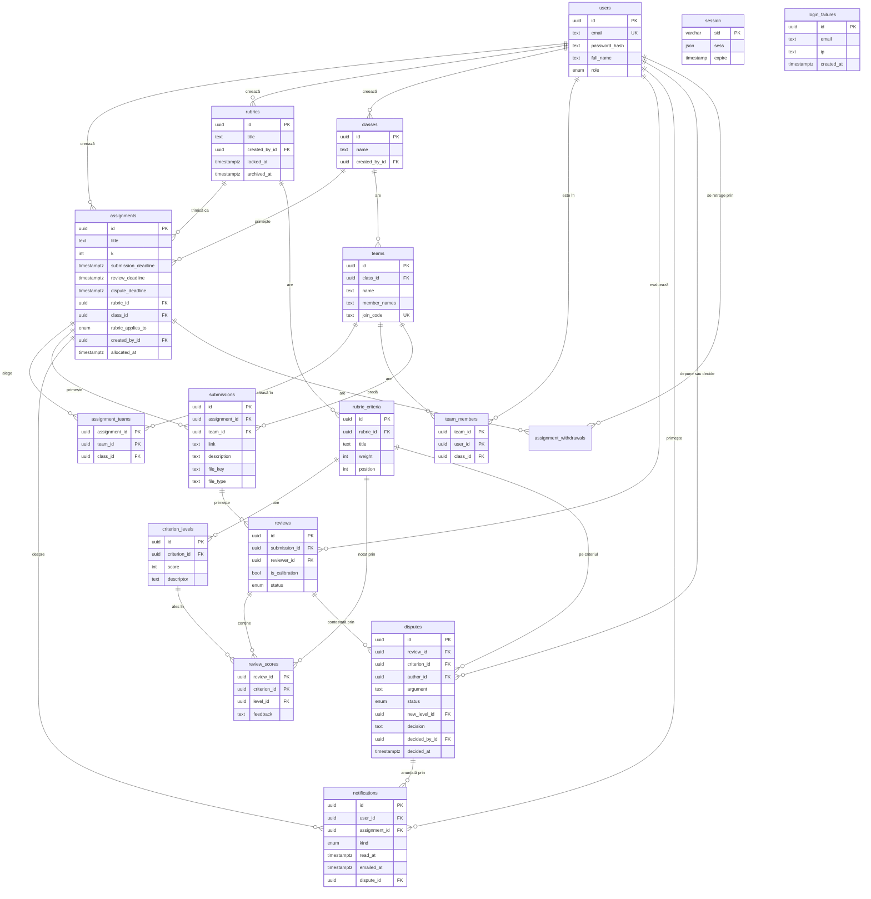

# Schema bazei de date

Sursa este [api/prisma/schema.prisma](../api/prisma/schema.prisma). Migrările versionate sunt în [api/prisma/migrations](../api/prisma/migrations).

Tabela `session` aparține bibliotecii `connect-pg-simple` și nu are relații cu celelalte tabele.

Tabela `login_failures` ține autentificările eșuate din ultimele 15 minute, pentru limita de încercări (D-017). Nu are relație cu `users`, ca un email inexistent să fie numărat la fel. Rândurile mai vechi de 15 minute se șterg la fiecare eșec nou.

## Reguli impuse de baza de date

| Regulă | Constrângere |
|---|---|
| Un email aparține unui singur cont | `users.email` unic |
| Un evaluator evaluează o predare o singură dată | `reviews (submission_id, reviewer_id)` unic |
| Un student este într-o singură echipă per clasă | `team_members (class_id, user_id)` unic |
| Membrul și echipa aparțin aceleiași clase | cheie străină compusă pe `teams (id, class_id)` |
| O echipă aleasă pentru o temă este din clasa temei | chei străine compuse pe `assignments (id, class_id)` și `teams (id, class_id)` |
| Codul unei echipe este unic | `teams.join_code` unic |
| O echipă are o singură predare per temă | `submissions (assignment_id, team_id)` unic |
| Fișierul unei predări este PDF sau DOCX | `CHECK file_type IN ('pdf', 'docx')` |
| Un token din email este salvat doar ca hash și este unic | `email_tokens.token_hash` unic (SHA-256) |
| Fiecare temă are un cod de înscriere unic, generat de baza de date | `assignments.join_code` unic, implicit `gen_random_uuid()` |
| Un evaluator intră o singură dată într-o temă | cheie primară `assignment_reviewers (assignment_id, user_id)` |
| O clasă cu teme trimise nu se șterge | cheie străină `ON DELETE RESTRICT` din `assignments` |
| Nimeni nu evaluează predarea propriei echipe (D-022) | trigger `reviews_guard_own_team` |
| Un student se retrage o singură dată dintr-o temă (D-022) | cheie primară `assignment_withdrawals (assignment_id, user_id)` |
| O singură notificare per student, temă și eveniment (D-024) | `notifications (user_id, assignment_id, kind)` unic |
| Un criteriu are un singur scor per evaluare | cheie primară `review_scores (review_id, criterion_id)` |
| Feedback de cel puțin 20 de caractere, fără spațiile de la capete (D-023) | `CHECK review_scores_feedback_length` |
| Nivelul ales aparține criteriului notat (D-023) | cheie străină `review_scores (level_id, criterion_id)` → `criterion_levels (id, criterion_id)` |
| Criteriul notat e din grila temei, iar o evaluare trimisă nu primește scoruri noi (D-023) | trigger `review_scores_guard` |
| O evaluare devine `SUBMITTED` doar cu toate criteriile notate și apoi nu se mai schimbă (D-023) | trigger `reviews_guard_update` |
| Doar profesorul care a creat tema scrie evaluări de calibrare, și doar pe acestea (D-025) | trigger `reviews_guard_calibration` |
| O singură contestație per evaluare și criteriu (D-027) | `disputes (review_id, criterion_id)` unic |
| Argument de cel puțin 20 de caractere; decizie de cel puțin 20 de caractere și nivel nou doar la admitere (D-027) | `CHECK disputes_argument_length`, `CHECK disputes_decision_state` |
| Nivelul nou aparține criteriului contestat (D-027) | cheie străină `disputes (new_level_id, criterion_id)` → `criterion_levels (id, criterion_id)` |
| Contestă doar un membru al echipei evaluate, pe o evaluare trimisă; hotărăște doar profesorul temei, o singură dată (D-027) | trigger `disputes_guard` |
| O notificare per student, temă și eveniment, sau per student și contestație (D-024, D-027) | indexuri unice parțiale pe `notifications` |
| `k` este cel puțin 1 | `CHECK` în migrare |
| Termenele sunt în ordine: predare, evaluare, contestații | `CHECK` în migrare |
| Ponderea unui criteriu este pozitivă | `CHECK` în migrare |
| O grilă are cel mult 100 de criterii | `rubric_criteria (rubric_id, position)` unic și `CHECK position BETWEEN 1 AND 100` |
| Trimiterea către o clasă blochează grila (D-013) | trigger `assignments_lock_rubric` setează `rubrics.locked_at` |
| Primul scor salvat blochează grila, ca plasă de siguranță | trigger `review_scores_lock_rubric` |
| Criteriile și nivelurile unei grile blocate nu se schimbă | triggerele `rubric_criteria_guard_locked` și `criterion_levels_guard_locked` |
| O grilă blocată nu se deblochează | trigger `rubrics_guard_update` |
| O grilă trimisă nu se șterge | chei străine `ON DELETE RESTRICT` din `assignments` și `review_scores` |
| Arhivarea e permisă la 2 zile după ultimul termen de evaluare al temelor care folosesc grila | trigger `rubrics_guard_update`; `archived_at` primește ora serverului |
| O grilă arhivată nu poate fi trimisă | trigger `assignments_guard_archived_rubric` |

## Ce echipe sunt evaluate (D-011, D-013)

Regula este în [api/src/assignments/assignment-scope.ts](../api/src/assignments/assignment-scope.ts):

1. Dacă tema are `rubric_applies_to = ALL`, sunt evaluate toate echipele clasei.
2. Dacă are `SELECTED`, sunt evaluate doar echipele din `assignment_teams`.
3. O echipă lăsată pe dinafară nu intră în alocare. Membrii ei pot evalua în continuare.

Pentru altă grilă la alte echipe, profesorul trimite încă o grilă aceleiași clase, cu alte echipe alese.

## Alocarea (D-022)

Regulile sunt funcții pure în [api/src/allocation/allocate.ts](../api/src/allocation/allocate.ts); [allocation.service.ts](../api/src/allocation/allocation.service.ts) le aplică într-o tranzacție care blochează rândul temei (`SELECT ... FOR UPDATE`).

1. Un job pg-boss (D-021) rulează în fiecare minut și alocă temele cu termenul de predare trecut și `allocated_at` gol, apoi setează `allocated_at`.
2. Evaluatorii sunt membrii echipelor clasei și cei din `assignment_reviewers`, fără cei din `assignment_withdrawals`.
3. O evaluare `ALLOCATED` (încă netrimisă) se poate muta; una `SUBMITTED` rămâne.

## Notificările (D-024)

Același job pg-boss, după alocare, înregistrează notificările datorate și apoi trimite pe email cel mult 50 pe rulare, pe cele cu `emailed_at` gol. Un email eșuat rămâne cu `emailed_at` gol și se reîncearcă la rularea următoare. Textul se construiește la afișare, din temă și din evaluările studentului, deci nu e stocat.

| `kind` | Când | Cui |
|---|---|---|
| `REVIEWS_ALLOCATED` | după alocare, cât timp termenul de evaluare nu a trecut | fiecărui evaluator, o dată |
| `REVIEW_REMINDER` | în ultimele 24 de ore dinaintea termenului de evaluare | evaluatorilor cu evaluări netrimise, care nu s-au retras |
| `SUBMISSION_REMINDER` | în ultimele 24 de ore dinaintea termenului de predare | membrilor echipelor evaluate fără predare |

Doar conturile confirmate primesc notificări.
