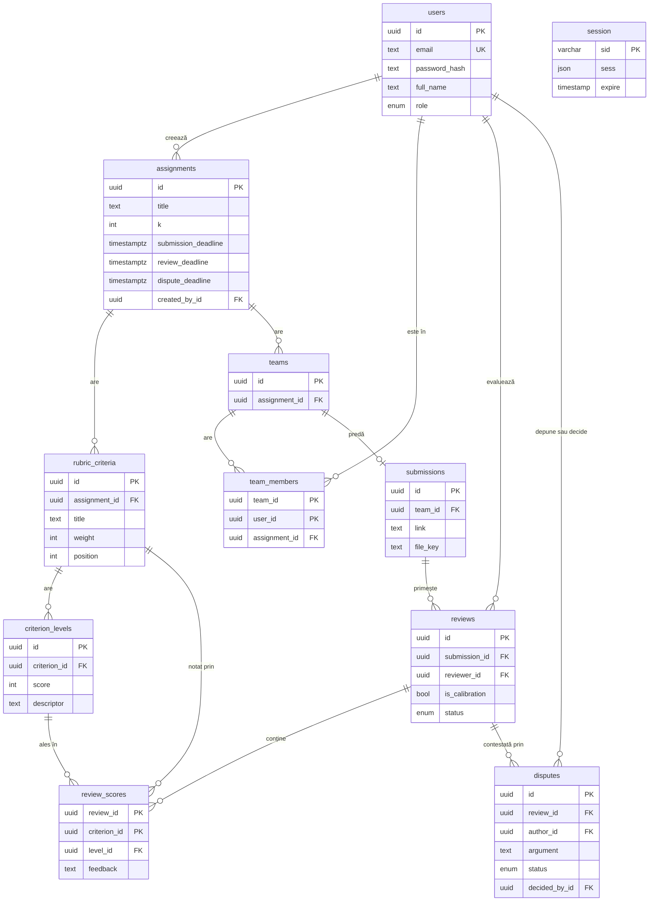

# Schema bazei de date

Sursa este [api/prisma/schema.prisma](../api/prisma/schema.prisma). Migrările versionate sunt în [api/prisma/migrations](../api/prisma/migrations).

Tabela `session` aparține bibliotecii `connect-pg-simple` și nu are relații cu celelalte tabele.

## Reguli impuse de baza de date

| Regulă | Constrângere |
|---|---|
| Un email aparține unui singur cont | `users.email` unic |
| Un evaluator evaluează o predare o singură dată | `reviews (submission_id, reviewer_id)` unic |
| Un student este într-o singură echipă per temă | `team_members (assignment_id, user_id)` unic |
| Membrul și echipa aparțin aceleiași teme | cheie străină compusă pe `teams (id, assignment_id)` |
| O echipă are o singură predare | `submissions.team_id` unic |
| Un criteriu are un singur scor per evaluare | cheie primară `review_scores (review_id, criterion_id)` |
| `k` este cel puțin 1 | `CHECK` în migrare |
| Termenele sunt în ordine: predare, evaluare, contestații | `CHECK` în migrare |
| Ponderea unui criteriu este pozitivă | `CHECK` în migrare |
