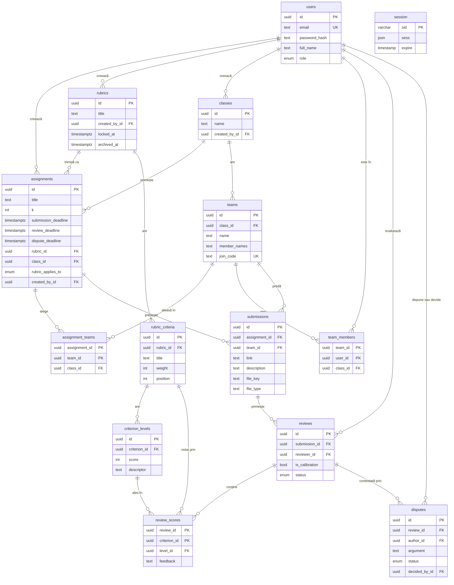

# Schema bazei de date

Sursa este [api/prisma/schema.prisma](../api/prisma/schema.prisma). Migrările versionate sunt în [api/prisma/migrations](../api/prisma/migrations).

Tabela `session` aparține bibliotecii `connect-pg-simple` și nu are relații cu celelalte tabele.

## Reguli impuse de baza de date

| Regulă | Constrângere |
|---|---|
| Un email aparține unui singur cont | `users.email` unic |
| Un evaluator evaluează o predare o singură dată | `reviews (submission_id, reviewer_id)` unic |
| Un student este într-o singură echipă per clasă | `team_members (class_id, user_id)` unic |
| Membrul și echipa aparțin aceleiași clase | cheie străină compusă pe `teams (id, class_id)` |
| O echipă aleasă pentru o temă este din clasa temei | chei străine compuse pe `assignments (id, class_id)` și `teams (id, class_id)` |
| Codul unei echipe este unic | `teams.join_code` unic |
| O echipă are o singură predare per temă | `submissions (assignment_id, team_id)` unic |
| Fișierul unei predări este PDF sau DOCX | `CHECK file_type IN ('pdf', 'docx')` |
| O clasă cu teme trimise nu se șterge | cheie străină `ON DELETE RESTRICT` din `assignments` |
| Un criteriu are un singur scor per evaluare | cheie primară `review_scores (review_id, criterion_id)` |
| `k` este cel puțin 1 | `CHECK` în migrare |
| Termenele sunt în ordine: predare, evaluare, contestații | `CHECK` în migrare |
| Ponderea unui criteriu este pozitivă | `CHECK` în migrare |
| O grilă are cel mult 100 de criterii | `rubric_criteria (rubric_id, position)` unic și `CHECK position BETWEEN 1 AND 100` |
| Trimiterea către o clasă blochează grila (D-013) | trigger `assignments_lock_rubric` setează `rubrics.locked_at` |
| Primul scor salvat blochează grila, ca plasă de siguranță | trigger `review_scores_lock_rubric` |
| Criteriile și nivelurile unei grile blocate nu se schimbă | triggerele `rubric_criteria_guard_locked` și `criterion_levels_guard_locked` |
| O grilă blocată nu se deblochează | trigger `rubrics_guard_update` |
| O grilă trimisă nu se șterge | chei străine `ON DELETE RESTRICT` din `assignments` și `review_scores` |
| Arhivarea e permisă la 2 zile după ultimul termen de evaluare al temelor care folosesc grila | trigger `rubrics_guard_update`; `archived_at` primește ora serverului |
| O grilă arhivată nu poate fi trimisă | trigger `assignments_guard_archived_rubric` |

## Ce echipe sunt evaluate (D-011, D-013)

Regula este în [api/src/assignments/assignment-scope.ts](../api/src/assignments/assignment-scope.ts):

1. Dacă tema are `rubric_applies_to = ALL`, sunt evaluate toate echipele clasei.
2. Dacă are `SELECTED`, sunt evaluate doar echipele din `assignment_teams`.
3. O echipă lăsată pe dinafară nu intră în alocare. Membrii ei pot evalua în continuare.

Pentru altă grilă la alte echipe, profesorul trimite încă o grilă aceleiași clase, cu alte echipe alese.
